<div align="center">

# Cardpack Morning Brief

**Your day as a booster pack.** Every morning a sealed foil pack is waiting for you in Claude.
Tear it open with your finger, draw your day card by card, tilt them in the light, and keep every day in a binder.

[**▶ Try the live demo**](https://gaiser147.github.io/cardpack-morning-brief/) · [**Set it up in one prompt**](#set-it-up-in-one-prompt) · [How it works](#how-it-works) · [Customize](#customize)

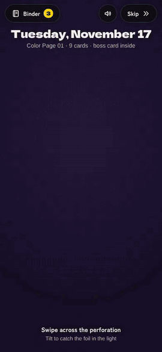

</div>

---

## What it is

A Claude **artifact** (a small web page that lives in your Claude account) plus a **recurring scheduled task**:

- Every morning the task reads your connected apps (calendar, mail, learning platform, to-dos, …), **read-only**, and turns your day into 4–9 trading cards.
- You open the same link every day, swipe across the perforation and pull out the cards one by one. The rarest card makes the pack glow; the next exam or big event is the red **boss card**.
- Afterwards your day sits in your hand as a fan (or as a list). Tap a card to zoom, stamp it **Done**, follow its link.
- Every pack is kept in the **binder**, with a streak counter and the number of cards you've collected.

<p align="center">
  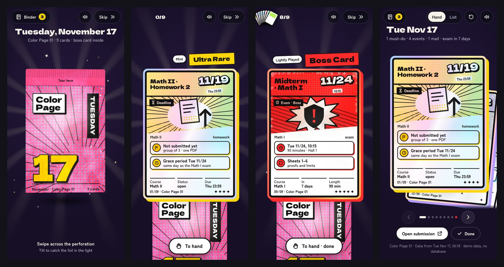
</p>

## See it in action

<table>
<tr>
<td align="center" width="50%"><b>Recorded on a real phone</b><br><sub>(the original German version, same page)</sub><br><br>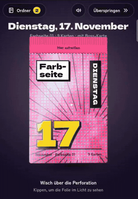</td>
<td align="center" width="50%"><b>The English version from this repo</b><br><sub>(headless browser, demo data)</sub><br><br></td>
</tr>
</table>

| Tear | Reveal | Boss card | Hand | List | Binder |
|:-:|:-:|:-:|:-:|:-:|:-:|
| 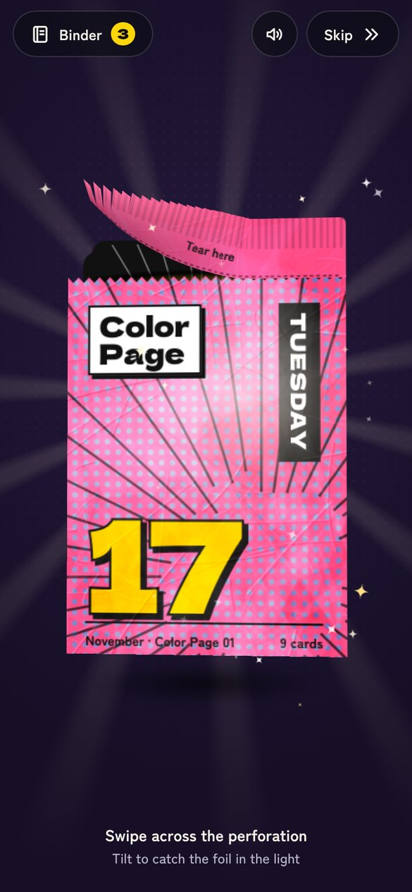 | 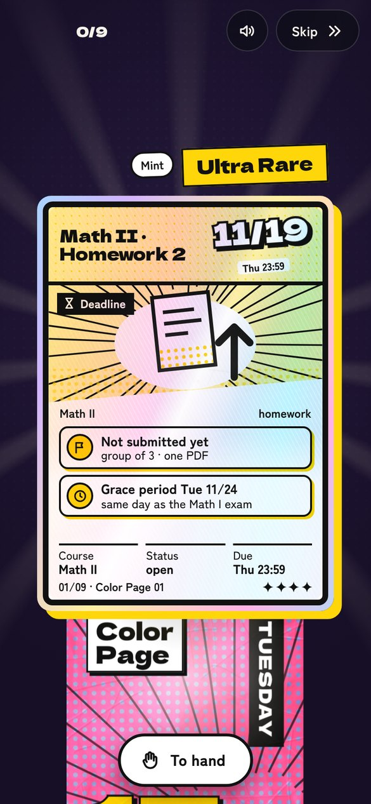 | 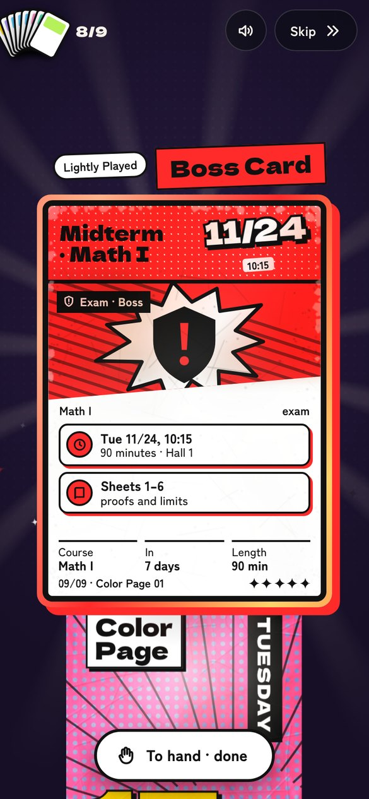 | 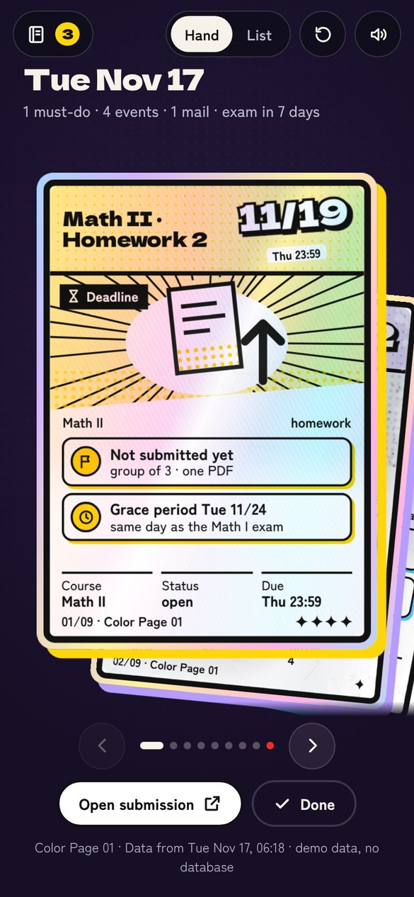 | 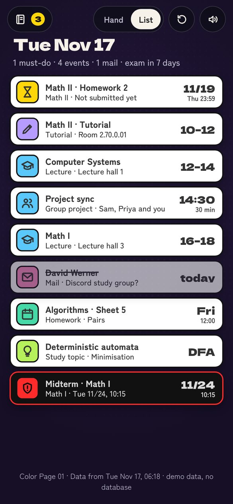 | 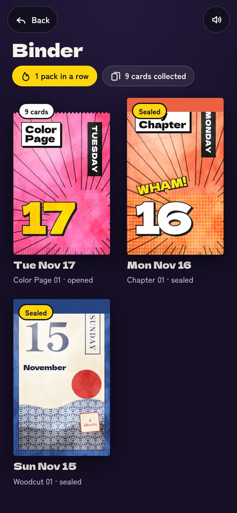 |
| swipe across the perforation; it tears hole by hole in 3D, with sound | each card slides out, flips and shows its rarity and wear | an exam or big event is always the red boss card, with flash and shake | swipe the fan, tap to zoom, stamp "Done", open the link | your whole day at a glance | every pack, a streak, cards collected |

### Three print series that rotate daily

| Chapter | Color Page | Woodcut |
|:-:|:-:|:-:|
| 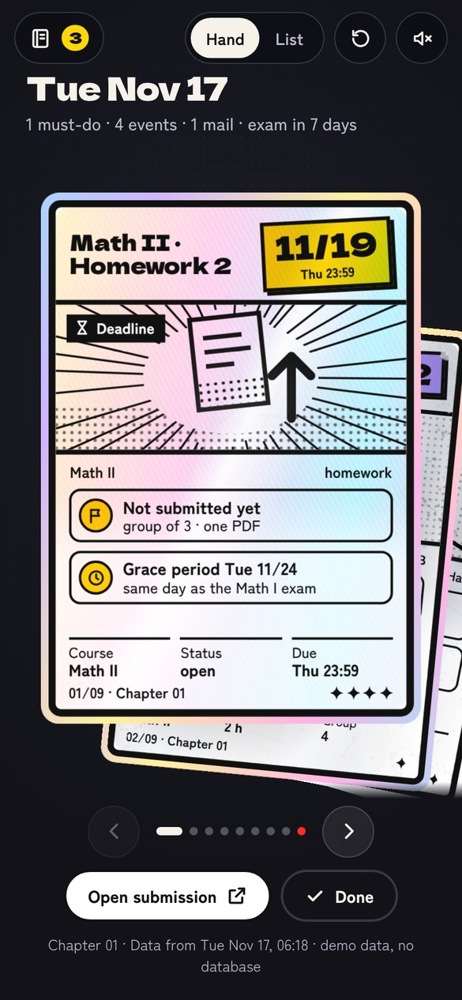 |  | 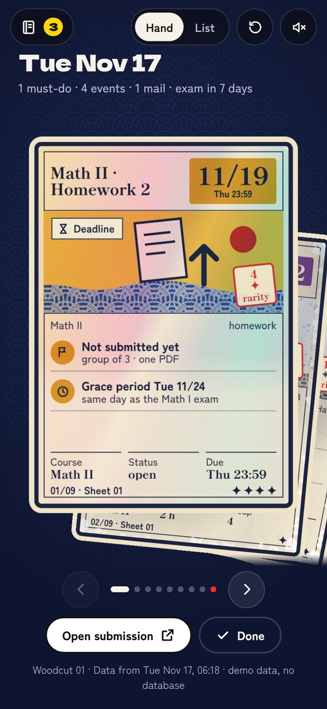 |
| manga ink with one spot colour | colour halftones, slanted panels | washi paper, flat woodblock pigments |

Each card also gets a foil (holo, chrome, gold, glitter or none), a rim and a wear grade from *Mint* to *Battle-Scarred*. All of it is rolled from the date, so a card looks the same every time you open it.

---

## Set it up in one prompt

**You need:** a Claude plan with **artifacts that have a database** and **scheduled tasks**, and the apps you want in your brief connected under *Settings → Connectors* (e.g. Google Calendar, Gmail). No connectors works too, the cards are just thinner.

Copy this into a new chat on [claude.ai](https://claude.ai). Claude checks which connectors you have, asks what belongs in your brief, publishes the page from this repo and creates the daily task.

```text
Set up "Cardpack Morning Brief" for me: every morning a sealed trading-card pack of my day that I tear open in an artifact. The page comes ready-made from https://github.com/gaiser147/cardpack-morning-brief. You publish it once, then a recurring scheduled task writes one new pack per day into the artifact's database. Work through these steps in order. Ask me before you publish or schedule anything.

1. CHECK MY CONNECTORS
Look at which connectors and tools you can use right now (calendar, mail, tasks/notes, learning platform, work tools, weather/news, …). Only list them, don't read my data yet. Show me a short list: connected and useful / connected but not useful / useful but missing. For the missing ones say in one line where I can add them.

2. ASK ME WHAT GOES IN THE BRIEF
Use your question tool if you have one (multiple choice, up to 4 questions per round, your recommendation first). Propose defaults from what you found instead of asking open questions. Ask about:
- Sources: which of my connected sources to use.
- Cards: which kinds I want. Options: today's ONE must-do (always on), today's events, meetings, lectures/tutorials, work shift, mails waiting on my reply, deadlines due this week, to-dos, a "boss card" for the next exam or big event (how many days ahead, default 21), a study topic, a heads-up (weather, commute, news on a topic I name).
- Timing: when the pack should be ready (default 06:30), every day or weekdays only, my time zone.
- Language for the card text (the page UI itself is English).
- Optional: 2–5 sentences about me and my fixed weekly schedule, used as a fallback when a source fails.
Briefly confirm the result before you continue.

3. GET THE PAGE FROM THE REPO
Download these files exactly as they are (use your code/bash tool, e.g. curl, or your web fetch tool):
- https://raw.githubusercontent.com/gaiser147/cardpack-morning-brief/main/artifact/morning-brief.html
- https://raw.githubusercontent.com/gaiser147/cardpack-morning-brief/main/artifact/examples/sample-pack.json
- https://raw.githubusercontent.com/gaiser147/cardpack-morning-brief/main/prompts/daily-task.md
Don't rewrite, shorten, "improve" or rebuild the page, and never recreate it from memory. If you can't download a file, tell me which one and ask me to attach it (I can download the repo as a ZIP from GitHub), then wait.

4. PUBLISH THE PAGE
Publish morning-brief.html unchanged as a new private artifact titled "Morning Brief" with exactly these capabilities:
{"db": {"rules": [{"path": "packs", "read": "view", "write": "owner"}, {"path": "data/users/{self}", "write": "interact"}]}, "user": {}}
(Only I/the task may write packs; the page stores which packs I opened and which cards I stamped under data/users/<me>.)
Then write sample-pack.json into the artifact's database as document packs/<today's date>, with date, label, weekday, day, month and stand set to today, so I can test the page right away. Give me the link.

5. FILL IN THE DAILY TASK
Take daily-task.md, keep only the part below the line, and replace every {{…}} with my answers: the artifact link, my name, language, time zone, ready-by time, context, weekly schedule, my real sources with their real connector names, and the card kinds I chose. Delete the sources and kinds I don't use. Don't loosen any of its rules (read only, never send or change anything, no invented data, length limits). Show me a 5-line summary, not the whole text.

6. CREATE THE RECURRING TASK
Create a scheduled task named "Morning Brief" that runs at the chosen time and days in my time zone (start it about 15 minutes before the ready-by time), with the filled text as its instructions and only the connectors it needs. Then offer to run it once now so a real pack for today replaces the sample.

At the end tell me in a few lines: the artifact link, when it runs, which sources it reads, and how to change it later (sources, time, card kinds).
```

The same prompt lives in [`prompts/setup-prompt.md`](prompts/setup-prompt.md), together with the manual steps if you'd rather do it by hand.

**After setup** you get a push notification every morning, e.g. *"Your daily pack is here: Physics sheet 3 · Boss card: Programming quiz in 9 days"*. Always open the same link. To change something later, just ask Claude: *"Update my Morning Brief task: also read my Todoist and run at 07:00."*

---

## How it works

```
 Scheduled task (e.g. 06:15)               Artifact "Morning Brief"
 ┌───────────────────────────────┐         ┌──────────────────────────────────────────┐
 │ reads calendar, mail, portal, │  write  │ database: packs/2026-11-17  (one per day) │
 │ to-dos … (read only)          │ ──────► │                │                         │
 │ builds 4–9 cards as JSON      │         │                ▼                         │
 │ picks series, palette, light  │         │ page: tear the pack, draw cards, hand,    │
 └───────────────────────────────┘         │       list, binder, done stamps           │
                                           └──────────────────────────────────────────┘
```

- **The page never changes.** It's one self-contained HTML file ([`artifact/morning-brief.html`](artifact/morning-brief.html)), published once. The task only writes data.
- **One JSON document per day** in the artifact's own database, see [pack format](guide/pack-format.md). The page loads the newest 90 packs.
- **The task decides content, order and rarity**: the one must-do of the day is rarity 4 (holo), the boss card rarity 5 (red), later-this-week deadlines rarity 3, and so on ([task template](prompts/daily-task.md)).
- **The page decides the look**: foil, rim, texture and wear are rolled from the pack's seed, so every reload looks identical.
- **Your progress** (which packs you opened, which cards you stamped) is stored per viewer under `data/users/<you>`.

### Card kinds

| Kind | Shows up as | Typical source |
|---|---|---|
| `deadline` | gold hourglass card, the must-do is holo | learning platform, to-dos |
| `boss` | **red boss card** with flash and shake | exams, launches, interviews in the next 21 days |
| `lecture` · `tutorial` · `meeting` · `event` | today's schedule, in chronological order | calendar |
| `focus` · `work` | study/deep-work blocks, shifts | calendar, shift plan |
| `mail` | "Waiting on you": a person who needs your reply | mail (no newsletters or automated mail) |
| `task` · `week` | to-dos today, deadlines later this week | to-do app, learning platform |
| `learn` · `info` | one study topic, one heads-up (weather, strikes, news) | notes, grades, news |
| `free` | an honest empty card when nothing is on | – |

### What the page does

- **Foil pack** with 3D tilt and moving light. Tear it with a swipe across the perforation; the strip comes off in 30 slices with a tearing sound.
- **Drawing cards**: pull each card out of the pack, it flips and shows its rarity (*Common* to *Ultra Rare*, plus the *Boss Card*) and wear grade.
- **Hand fan** to swipe through, **list** view, **zoom** with tilt, **Done** stamps, links (only to submissions, mail threads or polls).
- **Binder** with every pack, sealed or opened, a streak and a card count.
- **Sound** is synthesised live, no audio files; mute at the top right.
- **Accessible**: "reduce motion" opens straight on the hand, everything works by keyboard, every card has a screen-reader description.
- **No assets**: art is inline SVG, textures are drawn on canvas at runtime, fonts come from Google Fonts.

## Privacy

- The task only **reads** your sources. It sends nothing, drafts nothing, changes nothing in your calendar, mail or anywhere else.
- Everything ends up in the database of **your own private artifact**. Nobody sees it unless you share the link.
- Card links are limited to submission pages, mail threads and polls, never money, contracts, health or credentials.

---

## Customize

| I want to… | Do this |
|---|---|
| change what's on the cards | ask Claude to edit your scheduled task, or edit [`prompts/daily-task.md`](prompts/daily-task.md) and recreate it |
| change the time | ask Claude: *"Run my Morning Brief task at 07:00 on weekdays"* |
| card text in another language | set the language in the task; the cards follow. The page UI strings live in [`artifact/src/app2.js`](artifact/src/app2.js) and [`artifact/src/body.html`](artifact/src/body.html) |
| change the look | [`artifact/src/style.css`](artifact/src/style.css); series, palettes and kinds are at the top of [`artifact/src/app1.js`](artifact/src/app1.js) (`SERIES`, `KIND`). The design system is in [`guide/design.md`](guide/design.md) |
| add a new card kind | add it to `KIND` in `app1.js` (label, icon, hue), optionally a motif in `mangaMotif` / `woodMotif`, then mention it in your task |

**Rebuilding** after you change `src/`:

```bash
python3 artifact/build.py             # -> artifact/morning-brief.html (publish this)
python3 artifact/build.py --preview   # same, with a series switcher and flicker diagnostics
python3 artifact/build.py --demo      # -> docs/demo.html for GitHub Pages (three demo packs)
```

Then ask Claude to publish the new `morning-brief.html` **to the same artifact** (same link), so your database and packs stay.

**Test locally**: open `artifact/morning-brief.html` or `docs/demo.html` in a browser. Without a database it shows the baked-in demo data. Add `?series=chapter`, `?series=color` or `?series=woodcut` to force a series.

**Older Android phones**: the 3D effects are at the limit there. The page is already optimised for it (one flat layer per card, the light rays painted into a small canvas). If it still flickers, build with `--preview` and use the diagnostics buttons below the hand to narrow it down.

## Files

```
artifact/
  morning-brief.html        the finished page: publish this as the artifact
  build.py                  builds it from src/ (and the demo for GitHub Pages)
  src/style.css             look
  src/body.html             markup (+ placeholder for the baked-in pack)
  src/app1.js               series, card kinds, card rendering, textures, sound
  src/app2.js               flow: storage, tearing, drawing, hand, list, binder
  examples/sample-pack.json one pack, written into the database during setup
  examples/demo-packs.json  the three packs of the live demo
prompts/
  setup-prompt.md           the copy-paste setup prompt
  daily-task.md             template for the daily scheduled task
guide/
  pack-format.md            the JSON format of a pack
  design.md                 the design system
docs/                       GitHub Pages site (landing page + playable demo)
media/                      GIFs and screenshots for this README
```

## GitHub Pages

The [live demo](https://gaiser147.github.io/cardpack-morning-brief/) is served from the `docs/` folder. If you fork this repo: *Settings → Pages → Deploy from a branch → `main` / `docs`*.

## License

[MIT](LICENSE). Fonts: [Dela Gothic One](https://fonts.google.com/specimen/Dela+Gothic+One), [Zen Kaku Gothic New](https://fonts.google.com/specimen/Zen+Kaku+Gothic+New) and [Shippori Mincho B1](https://fonts.google.com/specimen/Shippori+Mincho+B1), all under the SIL Open Font License, loaded from Google Fonts.
